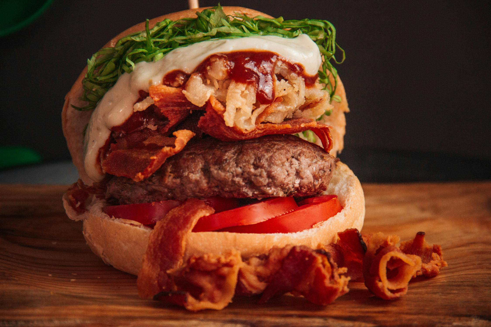

# 🍔 Will Burguer — Site de Hamburgueria

[](https://developer.mozilla.org/pt-BR/docs/Web/HTML)
[](https://developer.mozilla.org/pt-BR/docs/Web/CSS)
[](https://developer.mozilla.org/pt-BR/docs/Web/JavaScript)
[](./LICENSE)

Site completo de cardápio digital para hamburgueria, com carrinho de compras funcional e integração com WhatsApp para finalização de pedidos.

> 🔗 **[Ver demo ao vivo →](https://willsonbs.github.io/projeto-site-hamburgueria/)**

---

## 📸 Preview



---

## ✨ Funcionalidades

- **Cardápio interativo** com hambúrguers e bebidas
- **Carrinho de compras** com adicionar, remover e contagem de itens
- **Status da loja em tempo real** (aberto/fechado por horário)
- **Integração com WhatsApp** para finalizar pedidos diretamente
- **Modal responsivo** com resumo do pedido e campo de endereço
- **Notificação toast** quando a loja está fechada
- **Layout responsivo** para mobile e desktop

---

## 🛠️ Tecnologias

| Tecnologia | Uso |
|---|---|
| HTML5 | Estrutura semântica da página |
| CSS3 | Estilização com variáveis CSS, Grid e Flexbox |
| JavaScript (ES6+) | Lógica do carrinho e integração WhatsApp |
| [Font Awesome](https://fontawesome.com/) | Ícones |
| [Toastify.js](https://apvarun.github.io/toastify-js/) | Notificações toast |

---

## 📁 Estrutura do Projeto

```
projeto-site-hamburgueria/
├── index.html          # Página principal
├── script.js           # Lógica do carrinho e pedido
├── style/
│   └── style.css       # Estilos e variáveis CSS
├── assets/             # Imagens dos produtos e wallpaper
├── fonts/              # Fontes customizadas
└── LICENSE
```

---

## 🚀 Como Rodar Localmente

Não requer instalação — é puro HTML/CSS/JS.

```bash
# Clone o repositório
git clone https://github.com/Willsonbs/projeto-site-hamburgueria.git

# Acesse a pasta
cd projeto-site-hamburgueria

# Abra no navegador
open index.html
```

Ou use a extensão [Live Server](https://marketplace.visualstudio.com/items?itemName=ritwickdey.LiveServer) no VS Code para hot reload.

---

## 🧠 Aprendizados

Projeto desenvolvido durante o curso prático para consolidar:

- Manipulação do DOM com JavaScript vanilla
- Event delegation para elementos dinâmicos
- CSS Grid e Flexbox para layouts responsivos
- Variáveis CSS (custom properties)
- Integração com a API do WhatsApp via `wa.me`
- Controle de estado com array em memória

---

## 📄 Licença

Distribuído sob a licença MIT. Veja [LICENSE](./LICENSE) para mais informações.

---

<p align="center">Feito com ❤️ por <a href="https://github.com/Willsonbs">Wilson</a></p>
